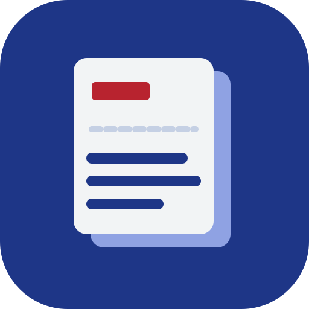

# ClipSync

Copy on one device and it appears on your others in about a second: text, links, images and small files. Laptops on the same network talk directly; everything else goes through a relay you run yourself. Clips are end-to-end encrypted, so the relay only ever sees ciphertext.

```
 Laptop (macOS)          Desktop (Windows/Linux)        Phone (PWA)
 ┌──────────┐             ┌──────────┐                  ┌──────────┐
 │clipsyncd │◀── LAN ───▶│clipsyncd │                  │ web app  │
 └────┬─────┘ Noise/mDNS  └────┬─────┘                  └────┬─────┘
      └──────────── WSS ───────┴────────── WSS ──────────────┘
                     ┌───────────────────┐
                     │   relay (Go)      │  ← encrypted blobs only
                     └───────────────────┘
```

## Phones can't watch the clipboard

iOS and Android 10+ don't let background apps read the clipboard, so no app can sync a phone silently. Computers sync automatically. On the phone, ClipSync is a PWA:

- **Phone → computers:** tap **Send clipboard**, type or attach something, or use **Share → ClipSync** (Android; Safari doesn't support Web Share Target).
- **Computers → phone:** new clips appear instantly while the app is open; tap one to copy it.

KDE Connect and Apple's Universal Clipboard work within the same limits.

## Quick start

You need Go 1.27+ and, for the phone app, Node 24 with pnpm.

```sh
git clone https://github.com/meetmehta0685/Clipboard-Sync.git
cd Clipboard-Sync
make up        # builds what's missing, starts the relay, the daemon and the menu-bar app
```

That's it for this computer. Everything runs in the background and `make up` is safe to repeat.

```
make status    what's running, plus sync state and latency
make logs      follow all logs (make logs s=daemon for one)
make down      stop everything make up started
make restart   down, then up
make demo      pair two throwaway devices on this machine and check a clip syncs
```

To add another device, run `bin/clipsyncd pair` here. It shows a QR code and a link. On a phone, scan the QR. On another computer, run `make up` there, then `bin/clipsyncd join '<link>'`.

Other computers need to reach the relay, so point them (and this one) at an address they can all see:

```sh
bin/clipsyncd config relay_url ws://192.168.1.20:8787/ws   # this machine's LAN IP, or your wss:// host
```

If that address changes (a new Wi-Fi network), `make up` notices and prints the command to fix it.

**The phone app needs HTTPS.** Browsers only allow clipboard access, installing to the home screen and the share target in a secure context. Put the relay behind TLS (Caddy, a fly.io app, `tailscale serve`, or `-tls-cert/-tls-key`) and use its `wss://` URL as `relay_url`; the pairing QR points the phone at the same host.

### Deploying the relay

```sh
docker build -t clipsync-relay .
docker run -p 8787:8787 clipsync-relay
```

The relay keeps the last 50 clips per room in memory (`-history`, `-room-mb`, and `-total-mb` across all rooms) so devices that were asleep can catch up. A restart clears that buffer, and devices notice and resync from what's left.

## Using it

```
clipsyncd status          sync state, transports, measured latency
clipsyncd history -q foo  search recent clips (decrypted locally)
clipsyncd copy <id>       put an old clip back on the clipboard
clipsyncd send file.pdf   send a file (saved to ~/Downloads/ClipSync); stdin sends text
clipsyncd pause | resume  stop sending what you copy
clipsyncd devices         list the group
clipsyncd remove <name>   remove a device and rotate the group key
clipsyncd watch           live event stream
clipsync-tray             menu-bar app: status, pause, recent clips, pairing
```

Settings live in `~/Library/Application Support/clipsync/config.json` (or the OS equivalent); change them with `clipsyncd config <key> <value>`.

## Security design

| Piece | Choice |
|---|---|
| Device identity | X25519 keypair, stored in the OS keychain (`zalando/go-keyring`), with a 0600 file fallback for headless Linux |
| Clip encryption | XChaCha20-Poly1305 under a shared group key. The whole header (ID, origin, clock, epoch, type, size, chunk count) is associated data, so the relay can't splice a payload onto another header or replay a chunk at another index |
| Dedupe hash | HMAC-SHA256 under a key derived from the group key, **not** plain SHA-256. A plain hash would let the relay confirm guesses of short clips like "yes" or a 6-digit code |
| Relay room | Room ID and access token are HKDF outputs of the group key. The relay learns neither the key nor who is in the group |
| Pairing | The QR holds the inviter's public key and a one-time 128-bit code. Both sides meet in a relay room named by a hash of the code; the joiner proves it saw the code with an HMAC, and receives the group key sealed to its own public key (ephemeral-static and static-static X25519, HKDF). The code is in the URL fragment, which browsers never send, so the relay can't impersonate either side |
| LAN | `Noise_IK_25519_ChaChaPoly_BLAKE2s` (the WireGuard construction) over TCP, using the same identity keys. Only keys in the group's device list are accepted, and the prologue binds the current key epoch |
| Removing a device | A new group key is generated and sealed individually to each remaining device. Removed devices can't read anything sent afterwards, and they're in a different relay room |
| Password managers | Clips marked `org.nspasteboard.ConcealedType` / `TransientType` (macOS), `ExcludeClipboardContentFromMonitorProcessing` (Windows) or `x-kde-passwordManagerHint` (Linux) never leave the device. An optional filter also blocks things that look like private keys, cloud and API tokens, JWTs and Luhn-valid card numbers |
| History | Local SQLite, contents encrypted at rest with a separate device-local key |

The browser uses the same constructions via `@noble/*`; `testdata/vectors.json` and `web/test/js_vectors.json` check Go ↔ browser compatibility in both directions.

## Sync protocol

Each clip is an `Envelope` (see `internal/protocol`) sent on **every** available path (LAN and relay) and deduplicated on arrival. Choosing a path would be harder and slower to fail over.

| Problem | Fix |
|---|---|
| Echo loops | The watcher remembers what sync just wrote and ignores it. Polls and remote writes are serialized, so a stale read can't be mistaken for a new copy |
| Copy races a remote write | If you copied something the watcher hasn't seen yet, the remote write is skipped and your copy is sent with a higher clock, so every device converges on it |
| Duplicates | LRU of seen clip IDs |
| Ordering | Lamport clock; highest `(clock, device ID)` wins on every device |
| Large images | Chunked into 256 KiB pieces behind a two-lane queue, so text never waits behind a screenshot. Missing chunks are re-requested from the relay's store or the sender |
| Offline devices | The relay numbers what it stores per room, and devices resume from the last sequence number they saw. A Lamport-clock cursor would skip clips: a device that copied things while offline has advanced its own clock past clips it never received |
| Image formats | TIFF, BMP and JPEG are normalized to PNG before sending |

## Development

```sh
make demo                 # end-to-end smoke test: two devices, one relay, one clip
make test                 # go vet, go test -race, browser crypto vectors
cd web && pnpm dev        # PWA dev server (set NEXT_PUBLIC_RELAY_URL=ws://localhost:8787/ws
                          # and run the relay with -origins localhost:3000)
```

To run several daemons on one machine, give each its own profile and a file-backed clipboard (they would otherwise share one system clipboard):

```sh
clipsyncd -home /tmp/a -file-keystore -clipboard-file /tmp/a/clip.txt run
echo hello > /tmp/a/clip.txt      # "copy" on device a
```

Tests to know about:

- `internal/engine`: three simulated devices on an in-memory network. Echo loops, multipath dedupe, concurrent copies converging under message reordering, 60-chunk images surviving 30% chunk loss, key rotation locking out a removed device, path-traversal-safe file saves.
- `internal/hub`: real WebSocket clients against the relay. Catch-up after offline periods (including the clock-lag case above), relay restarts, room tokens, pairing-room limits.
- `internal/pairing`: pairing through a real relay, rejection without the code, and end-to-end sync over the relay.
- `internal/transport/lan`: Noise handshakes over TCP, frames larger than a Noise record, outsiders and stale epochs rejected.

## Layout

```
cmd/clipsyncd        daemon + CLI
cmd/relay            relay server (also serves web/out)
cmd/clipsync-tray    menu-bar app
internal/clipboard   Clipboard interface: macOS (AppKit via cgo), Windows, X11, Wayland, memory, file
internal/watcher     polling, filters, echo-loop guard
internal/protocol    envelope, Lamport clock, dedupe, chunk assembly
internal/crypto      keys, clip/control encryption, sealed boxes, pairing MACs
internal/engine      sync core
internal/transport   relay (WebSocket), lan (mDNS + Noise), memnet (tests)
internal/hub         relay rooms, replay, rate limits
internal/pairing     QR invite / join
internal/store       encrypted SQLite history
internal/daemon      wiring + local API on a Unix socket
web/                 Next.js PWA (phone client)
```

## Known limits

- Images are transferred eagerly; fetching full images only when you paste is not implemented.
- Files copied in Finder or Explorer aren't synced automatically; use `clipsyncd send`.
- Only the macOS clipboard backend has run on real hardware. The Windows and X11 backends need cgo and haven't been compiled yet (CI's Windows and Linux jobs are their first build); the Wayland backend and no-cgo builds compile for Linux and Windows.
- The relay accepts the first token presented for a room (trust on first use) and keeps storage in memory.
- On the phone, received images and files are kept only until the app is closed; text history persists.
